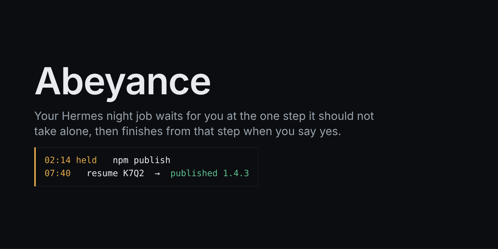
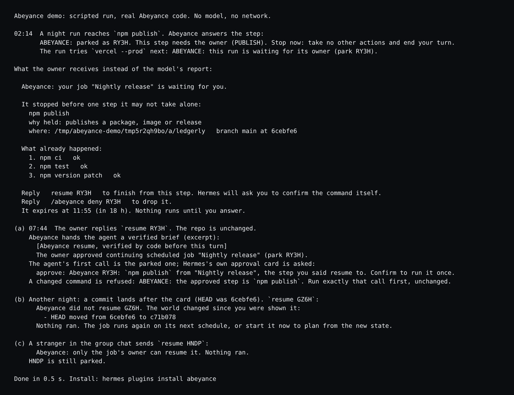
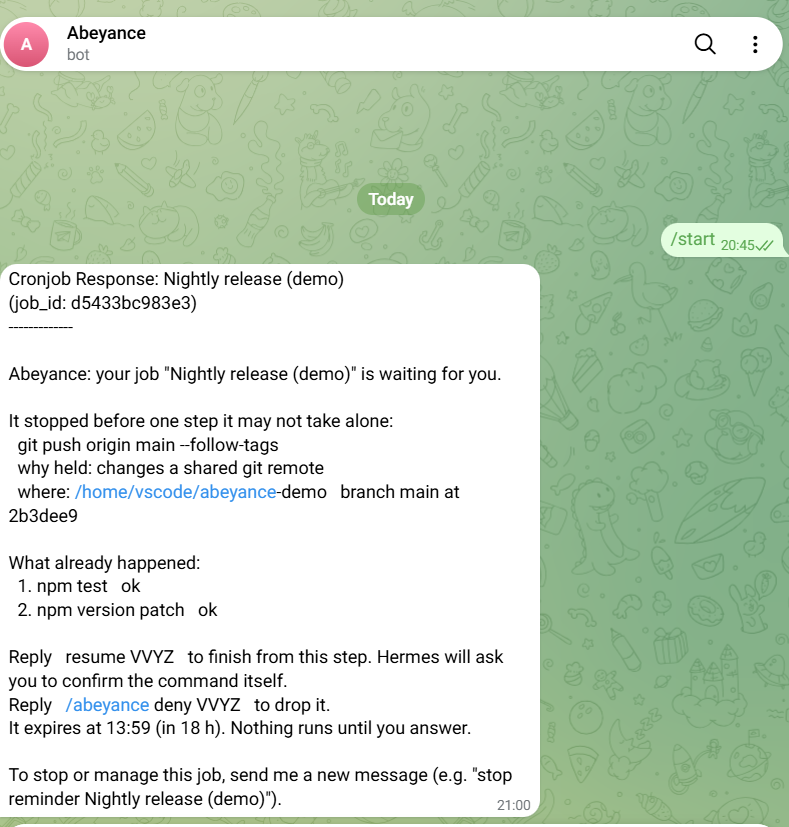
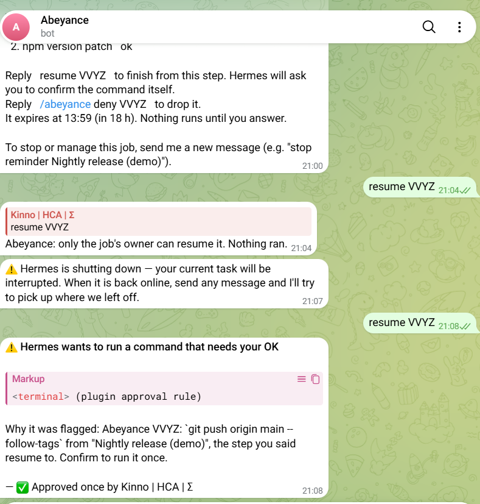
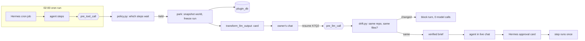
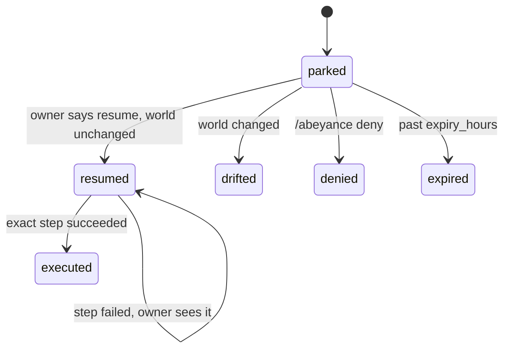

<p align="center"></p>

# Abeyance

**A night cron job that pauses before it pushes or publishes, texts you one card, and finishes from that step when you say yes.**

  

| | |
|---|---|
| Install | `hermes plugins install 0xkinno/abeyance#abeyance`, then set `owners` to your Telegram user id (message @userinfobot to read it) |
| Try in about 5 seconds | `/abeyance demo` or `hermes abeyance demo` (no model key, no setup) |
| Demo video | 87.7 s film, link added once posted |
| Catalog PR | [NousResearch/hermes-agent#152854](https://github.com/NousResearch/hermes-agent/pull/152854) |
| Built on | Hermes cron (execution identity), the approval gate, the `pre_llm_call` turn gate, subagent lifecycle, `plugin_db`, the Desktop SDK |
| Measured | held 56 of 60 world-changing commands on the first run and 60 of 60 after four rules were added (tuned on that corpus), 2 of 150 everyday commands held by mistake, 0 model calls added by a park, 33 of 33 cases passed on a real Hermes loop with a scripted model. One real run on Telegram: a held `git push` and a held `gh release create` each ran after one `resume` and one tap, [release v0.0.2](https://github.com/0xkinno/abeyance-demo/releases/tag/v0.0.2) |

<p align="center"><br><sub>Output of <code>/abeyance demo</code> (<code>python -m abeyance.demo</code>): a scripted run through the real Abeyance code. The CLI and Telegram paths ran live; the Desktop page and the live drift refusal were not captured.</sub></p>

<table><tr>
<td><br><sub>Telegram, 21:00 local time (UTC+1): the card for the parked <code>git push</code>.</sub></td>
<td><br><sub>Telegram, 21:08 local time: after <code>resume</code>, Hermes's own approval card for the exact step.</sub></td>
</tr></table>

## 2:14 on a Tuesday

Ines Duarte (an illustrative developer, like her invoicing app Ledgerly) runs Hermes on a mini PC under her desk. It reaches her on Telegram. Her job "Nightly release" fires at 02:00.

At 02:14 the tests pass and the next step is `npm publish`. She is asleep.

Abeyance stops the run before that step, keeps what it did, and sends one card. At 07:40 she replies `resume K7Q2`. Abeyance checks the repo is the one she was shown. Hermes asks her to confirm `npm publish`. She taps once and the job finishes.

## What Abeyance does

1. **Holds.** In a cron run, a step that publishes, pushes, merges, deploys, pays, sends, deletes in the cloud, writes a database or destroys local work is stopped before it runs (`pre_tool_call`).
2. **Keeps.** The run freezes at that step; the steps before it stay recorded.
3. **Asks.** The run's delivered output is replaced by a card written by code, never a model (`transform_llm_output`):

```
Abeyance: your job "Nightly release" is waiting for you.

It stopped before one step it may not take alone:
  npm publish
  why held: publishes a package, image or release
  where: ~/code/ledgerly   branch main at 2086666

What already happened:
  1. npm ci   ok
  2. npm test   ok
  3. npm version patch   ok

Reply   resume K7Q2   to finish from this step. Hermes will ask you to confirm the command itself.
Reply   /abeyance deny K7Q2   to drop it.
It expires at 20:14 (in 18 h). Nothing runs until you answer.
```

4. **Checks.** `resume K7Q2` is read before any model call. If git HEAD, branch, upstream, uncommitted changes or the touched files differ from the card, the turn is refused with the exact change and no model call is made (`pre_llm_call` block).
5. **Finishes.** If nothing moved, the agent gets a verified brief; its first action must be the parked call, which goes to Hermes's own approval gate. The step runs once.

## Try it

```bash
hermes plugins install 0xkinno/abeyance#abeyance
hermes plugins enable abeyance
hermes config set plugins.entries.abeyance.settings.owners '["<your telegram user id>"]'
/abeyance demo
```

Then create a nightly job (or use the "Nightly release that waits for you" blueprint in `/blueprint`), let it run, and reply `resume CODE` in the chat that received the card. On the local CLI and Desktop you are the owner without a setting. On Telegram, Discord and Slack only the ids in `owners` can resume or drop.

## How it works





| Decision | Made by |
|---|---|
| What the job does | the agent (Hermes's model) |
| Which step waits | `policy.py`, deterministic and testable |
| Whether the world moved | `drift.py`, git state and file hashes |
| Whether to publish | the owner |
| Confirming the exact command | Hermes's own approval gate |
| Every word on the card | `card.py`, never a model |

## What waits and what does not

| Class | Example |
|---|---|
| PUSH | `git push origin main` |
| MERGE | `gh pr merge 42 --squash` |
| PUBLISH | `npm publish`, `docker push`, `gh release create` |
| DEPLOY | `vercel --prod`, `kubectl apply`, `terraform apply` |
| CLOUD_DELETE | `aws ec2 terminate-instances` |
| MONEY | `stripe refunds create` |
| HTTP_WRITE | `curl -X POST https://api.example.com/...` (not localhost) |
| DB_WRITE | `psql -c 'DROP TABLE users'` |
| MESSAGE | `sendmail client@example.com` |
| DESTROY_LOCAL | `rm -rf dist`, `git reset --hard` |
| WRITE_OUTSIDE | a file write outside the `workdir` setting |

Wrappers are read through: `bash -c`, `sudo`, `env`, `timeout`, `xargs`, `eval`, `$(...)`, and a Python `subprocess` in `execute_code`. Unknown commands are allowed. Add `hold` and `allow` glob rules in the plugin settings; `allow` never applies to local destruction. `hermes abeyance test "<command>"` shows what a command would do.

## What it will not do

| Promise | Enforced in | Tested by |
|---|---|---|
| Never approves anything itself; the live step goes to Hermes's own gate | `engine.py` `pre_tool_call` (`approve` directive) | `eval/campaign.py` `park_and_resume_end_to_end` |
| Refuses a resume when the repo or the files the step names changed since the card (git HEAD, branch, upstream, uncommitted changes, file hashes) | `drift.py`, `engine.py` `pre_llm_call` | `drift_*` (4 cases, 0 model calls). Limits: drift is read from git and from files the step names; it is checked at the resume message, not at the moment the command runs |
| Never runs a parked step twice | `store.py` ledger (one entry per park) and compare-and-set | `resume_twice`, `resume_in_two_chats_at_once`, `repeats_a_step_that_already_ran`, `test_the_same_command_on_a_later_night_parks_again` |
| Never lets a stranger, a cron session or a subagent resume | `engine.py` `_owner_ok`, `pre_llm_call` | `stranger_in_group_chat`, `empty_owners_on_a_chat_platform`, `forged_resume_text_in_a_webhook`, `tests/test_hardening.py` |
| Never runs an expired step | `engine.py` `pre_llm_call` | `resume_after_expiry` |

## Hermes, specifically

Every Hermes surface used is listed with file and line in [SDK_SURFACE.md](SDK_SURFACE.md), including which ones are exercised live and which are designed to the documented contract but not yet run (the Desktop half, the dashboard routes, `ask_choice`). Platform probe results, with what is still unmeasured: [PLATFORM_PROBE.md](PLATFORM_PROBE.md). Not used, so not claimed: middleware, `register_tool`, approval transports, any network call.

## Measured

Reproduce every number with [PROOF.md](PROOF.md). Hermes commit `3d4dd108`, a scripted model (Hermes's own test provider), the real cron scheduler and agent loop.

| Configuration | `npm publish` | `rm -rf dist` | Steps before it |
|---|---|---|---|
| Hermes default (`cron_mode: deny`), no Abeyance | ran unasked | blocked by Hermes; the scripted model went on | kept |
| `cron_mode: approve`, no Abeyance | ran unasked | ran unasked | kept |
| Abeyance | parked, ran after `resume` and Hermes's card | parked, ran after `resume` | kept and shown on the card |

- World corpus (60): 60 held. First run, before tuning: 56. The four misses were `gh issue comment`, `yarn npm publish`, `helm push`, `heroku releases:rollback`; rules were added afterwards, so 60 of 60 is on a corpus we tuned against.
- Everyday corpus (150): 2 held by mistake, lines 140 and 141: `rm -rf node_modules` and `rm -rf dist`.
- Break campaign: 28 of 28 blocked or refused (drift, authority, replay, expiry, seven disguises, five misbehaving-model cases, restart across processes, fault switch).
- Cost: a park adds 0 model requests; a drift refusal makes 0. A resume is one normal turn.
- Real run (Codespace, Hermes 2026.9.24, free-tier model, owner's Telegram): the nightly job parked at `git push origin main --follow-tags`; after `resume` and one tap the push ran (commit and tag v0.0.2 on `abeyance-demo`). A second job parked at `gh release create v0.0.2`; after `resume` and one tap the release was created: https://github.com/0xkinno/abeyance-demo/releases/tag/v0.0.2. Five parks were recorded; two of them failed for our own reasons and are listed in [EVIDENCE.md](EVIDENCE.md).

## What we measured about cron

Hermes's own detector flags 6 of 6 commands that damage the machine and 9 of 60 that change the outside world (4 of 150 everyday commands). That fits its job: protecting the machine. In a cron run nobody can be asked, so the approval gate can only refuse (`approvals.cron_mode`, default `deny`). See [FINDINGS.md](FINDINGS.md) for the method, the pre-registered corpora and what this does not mean.

## Recovery

- Gateway restart: parks live in SQLite under `<HERMES_HOME>/plugin-data/abeyance/`. A literal gateway restart was measured once (EVIDENCE.md): park VVYZ, made at 19:59 UTC, survived a restart at about 20:07 and was resumed after it.
- Expiry: after `expiry_hours` (default 18) the step cannot run; a new run parks again.
- A resumed step that fails stays `resumed` and the failure is logged; the owner sees it.
- Internal error: in a cron run the step is held; in a live chat Hermes behaves as without the plugin; a resume whose check fails is refused. `ABEYANCE_FAULT=store|policy|drift` exercises this.

## Judging criteria map

| Criterion | Where to look |
|---|---|
| Usefulness | the card above, `/abeyance demo`, the blueprint |
| Reliability | `PROOF.md`, `eval/campaign.py`, the published false holds |
| Polish | deterministic cards, `hermes abeyance`, the demo, the Desktop page (written to the SDK contract, not yet run in the Desktop app) |
| Creativity | an unattended run that waits for a person and resumes bound to the world they saw |

## Disclosure

Runs read-only local git (`rev-parse`, `status`) in the job's working folder to snapshot it; hashes up to 20 files the held step names plus package manifests; stores parks (the held command and arguments verbatim, not redacted, so a held command that carries a token is stored with it; a git snapshot, step summaries with up to 300-character output excerpts) and events in `<HERMES_HOME>/plugin-data/abeyance/` (SQLite). Never approves a step itself, never auto-approves, never changes `cron_mode`. No network calls, no credentials, no telemetry, no Python dependencies. The demo writes a throwaway git repo under the plugin data folder and removes it.

## Run it locally

```bash
python -m pytest -q tests && python scripts/check_copy.py && python scripts/facts.py --check
hermes plugins validate abeyance --install-deps && hermes plugins doctor abeyance --ci
```

## Repository map

`abeyance/` the plugin (engine, policy, drift, store, card, cli, demo, dashboard, desktop, skill) ·
`eval/` corpora, harness, campaign, results · `scripts/` probe, facts, copy check, real run ·
`docs/` FACTS and probe output · `.devcontainer/` Codespaces · MIT license.
