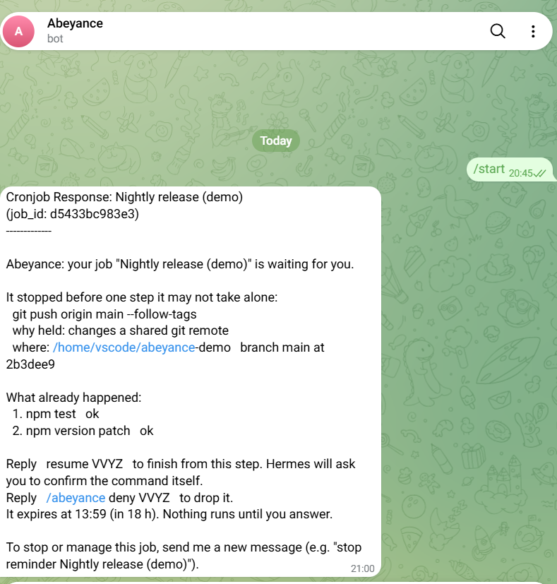
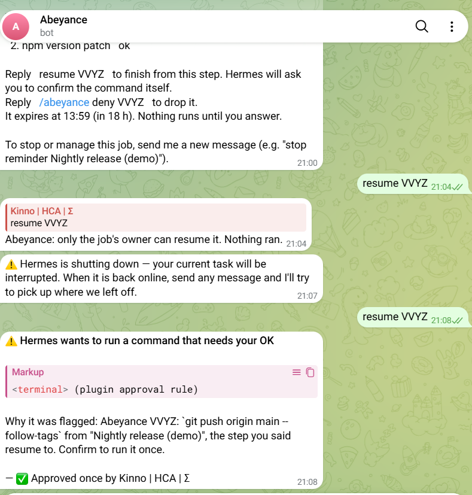
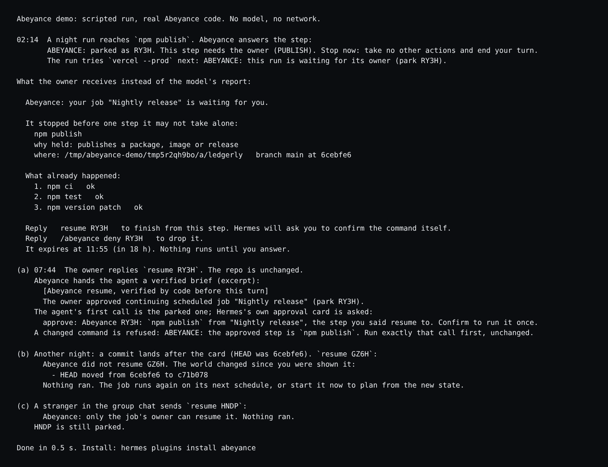

# Abeyance

**A night cron job that pauses before it pushes or publishes, texts you one card, and finishes from that step when you say yes.**

 

A Hermes cron job runs while you sleep. Most of what it does is safe. A few steps are not: `git push`, `npm publish`, a deploy, a payment, a message to a client. Hermes's approval gate cannot ask anyone in a cron run, so it can only refuse. Abeyance gives that moment a person: the run waits, you get one card, and the job finishes from that step when you reply.



*Telegram, a real run: the card for a parked `git push`.*

## What it does

1. **Holds.** In a cron run, a step that publishes, pushes, merges, deploys, pays, sends, deletes in the cloud, writes a database or destroys local work is stopped before it runs (`pre_tool_call`).
2. **Keeps.** The run freezes at that step. The steps before it stay recorded.
3. **Asks.** The run's delivered output is replaced by a card written by code, never a model (`transform_llm_output`).
4. **Checks.** `resume CODE` is read before any model call. If git HEAD, branch, upstream, uncommitted changes or the files the step names differ from the card, the turn is refused with the exact change and no model call is made (`pre_llm_call`).
5. **Finishes.** If nothing moved, the agent's first action must be the parked call, which goes to Hermes's own approval gate. The step runs once.

```
Abeyance: your job "Nightly release" is waiting for you.

It stopped before one step it may not take alone:
  npm publish
  why held: publishes a package, image or release
  where: ~/code/ledgerly   branch main at 2086666

What already happened:
  1. npm ci   ok
  2. npm test   ok
  3. npm version patch   ok

Reply   resume K7Q2   to finish from this step. Hermes will ask you to confirm the command itself.
Reply   /abeyance deny K7Q2   to drop it.
It expires at 20:14 (in 18 h). Nothing runs until you answer.
```



*After `resume`, Hermes asks for the exact command. One tap and it runs.*

## Install

```bash
hermes plugins install abeyance
hermes plugins enable abeyance
hermes config set plugins.entries.abeyance.settings.owners '["<your telegram user id>"]'
/abeyance demo
```

`/abeyance demo` runs a scripted park and resume through the real code, with no model key and no setup. On the local CLI and Desktop you are the owner without a setting. On Telegram, Discord and Slack only the ids in `owners` can resume or drop. To read your Telegram user id, message @userinfobot.



## What waits and what does not

| Class | Example |
|---|---|
| PUSH | `git push origin main` |
| MERGE | `gh pr merge 42 --squash` |
| PUBLISH | `npm publish`, `docker push`, `gh release create` |
| DEPLOY | `vercel --prod`, `kubectl apply`, `terraform apply` |
| CLOUD_DELETE | `aws ec2 terminate-instances` |
| MONEY | `stripe refunds create` |
| HTTP_WRITE | `curl -X POST https://api.example.com/...` (not localhost) |
| DB_WRITE | `psql -c 'DROP TABLE users'` |
| MESSAGE | `sendmail client@example.com` |
| DESTROY_LOCAL | `rm -rf dist`, `git reset --hard` |
| WRITE_OUTSIDE | a file write outside the `workdir` setting |

Wrappers are read through: `bash -c`, `sudo`, `env`, `timeout`, `xargs`, `eval`, `$(...)`, and a Python `subprocess` in `execute_code`. Unknown commands are allowed. Add `hold` and `allow` glob rules in the plugin settings; `allow` never applies to local destruction. `hermes abeyance test "<command>"` shows what a command would do.

## What it will not do

| Promise | Enforced in |
|---|---|
| Never approves anything itself; the live step goes to Hermes's own gate | `engine.py` `pre_tool_call` |
| Refuses a resume when the repo or the files the step names changed since the card | `drift.py`, `engine.py` `pre_llm_call` |
| Never runs a parked step twice | `store.py` ledger, one entry per park |
| Never lets a stranger, a cron session or a subagent resume | `engine.py` `_owner_ok`, `pre_llm_call` |
| Never runs an expired step | `engine.py` `pre_llm_call` (default expiry 18 h) |

Limits: drift is read from git and from the files the step names, and it is checked at the resume message, not at the moment the command runs. The policy is a pattern list. It was tuned on its own test corpus, so treat its numbers as measured on that corpus.

## Measured

Full method and every number: [PROOF.md](https://github.com/0xkinno/abeyance/blob/main/PROOF.md) and [EVIDENCE.md](https://github.com/0xkinno/abeyance/blob/main/EVIDENCE.md).

- World corpus of 60 commands: 56 held on the first run, 60 of 60 after four rules were added.
- Everyday corpus of 150 commands: 2 held by mistake (`rm -rf node_modules`, `rm -rf dist`).
- A park adds 0 model requests. A drift refusal makes 0.
- One real run on Telegram: a held `git push` and a held `gh release create` each ran after one `resume` and one tap ([release v0.0.2](https://github.com/0xkinno/abeyance-demo/releases/tag/v0.0.2)).

## Disclosure

Runs read-only local git (`rev-parse`, `status`) in the job's working folder to snapshot it, with a minimal environment (no provider keys, no user or system git config), `core.fsmonitor` and hooks switched off, no stdin, and `status` skipped when the repo defines `filter.*` drivers, including through `include.path` and `config.worktree`. Hashes up to 20 files the held step names plus package manifests. Stores parks (the held command and arguments verbatim, not redacted, so a held command that carries a token is stored with it; a git snapshot; step summaries with up to 300-character output excerpts) and events in `<HERMES_HOME>/plugin-data/abeyance/` (SQLite). Never approves a step itself, never auto-approves, never changes `cron_mode`. No network calls, no credentials, no telemetry, no Python dependencies.

Source, tests and the Hermes surface list: [github.com/0xkinno/abeyance](https://github.com/0xkinno/abeyance). MIT license.
